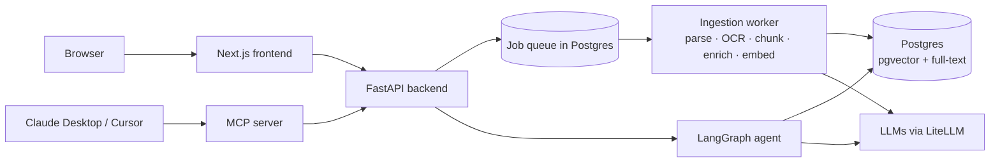

# DocMind: ask questions about your documents and get answers you can verify

DocMind is a document question-answering system (agentic RAG). Upload PDFs, scanned pages, or photos
of receipts, ask a question in plain English, and get an answer where **every claim links to the exact
page and region it came from**.

## The problem

Teams keep important information in PDFs: annual reports, policies, contracts, invoices, manuals.
Finding one fact means scrolling through hundreds of pages. Typical "chat with your PDF" tools
help, but they have well-known weaknesses:

- **They make things up.** When the answer isn't in the document, they often guess.
- **They get numbers wrong.** LLMs are unreliable at arithmetic, such as "what share of revenue came from Cloud?"
- **They can't read everything.** Charts, tables, and scanned pages are often ignored.
- **You can't check them.** Without precise sources, you have to trust the answer blindly.

## The solution

| Problem | How DocMind handles it |
|---|---|
| Made-up answers | Answers use only retrieved passages. A second model **fact-checks every claim** against its sources, and the answer is revised if something isn't supported. If the documents don't contain the answer, it says so. |
| Wrong numbers | The LLM only decides *which* table cells to use. **Python does the arithmetic**, so "48.4%" is exact. |
| Charts, tables, and scans | Layout-aware parsing reads tables as grids, **OCR** reads scans, and a **vision model** describes charts so values inside images become searchable. |
| Can't verify | Every sentence carries a citation. Click it and the PDF opens with **the source region highlighted**. Each answer also shows a confidence score computed from the evidence. |

## How it works

**1. When you upload a document**

```
Upload ─▶ Read (layout + OCR) ─▶ Summarize charts & tables ─▶ Split into chunks ─▶ Index
```

1. **Check:** the file type is verified from its contents, its size is limited, and duplicates are skipped.
2. **Read:** short documents go through [Docling](https://github.com/docling-project/docling), which
   understands layout (headings, tables, figures) and runs OCR on scanned pages. Long PDFs use a fast
   text reader, with OCR only on pages that need it.
3. **Enrich:** an LLM writes a title and summary for the document, summarizes each table, and describes each chart.
4. **Chunk:** text is split along sections into pieces of about 450 tokens. Each piece is labelled
   with where it came from, for example `Annual Report › Revenue — page 3`.
5. **Index in two stages:** chunks are saved to Postgres and become keyword-searchable within seconds.
   Embeddings for meaning-based search are added in the background.

**2. When you ask a question**

```
Understand ─▶ Plan ─▶ Search / Calculate ─▶ Write answer ─▶ Fact-check ─▶ Show with citations
```

1. **Understand:** a follow-up like "and in Q4?" is rewritten into a complete question.
2. **Plan:** an AI agent chooses a tool: search the documents, calculate over a table, or summarize a document.
3. **Search:** hybrid search combines meaning-based search (vectors) with keyword search.
4. **Calculate:** for maths questions, Python computes the result from the table cells.
5. **Answer:** the LLM writes a short answer with citations like `[S1]`, streamed live.
6. **Fact-check:** a second model checks each claim against its sources. If a claim isn't supported, the answer is revised once.
7. **Show:** you see the answer, a confidence score, and citations that open the highlighted page.

## Results

Measured on a test set built to be hard: **47 questions over 9 documents**. It includes look-alike
documents from other companies and years, facts that exist only inside charts or scanned pages,
maths questions, and questions that have no answer. Each answer is graded twice: by an exact-fact
check, and by an LLM judge from a different model family.

| | Basic RAG | + Hybrid search | **Full agent** |
|---|---|---|---|
| Correct answers (exact-fact check) | 97.9% | 100% | **97.9%** |
| Correct answers (LLM judge) | 100% | 95.7% | **95.7%** |
| Correct source page cited | 95.5% | 97.7% | **97.7%** |
| Unanswerable questions correctly declined | 100% | 100% | **100%** |
| Answerable questions wrongly declined | 2.3% | 0% | **0%** |

The three columns are three versions of the system, each adding one layer to the previous one:

- **Basic RAG** is the classic baseline. It finds the most similar chunks with vector search and
  asks the LLM to answer from them in a single call.
- **Hybrid search** also runs keyword search and merges both result lists. This helps with exact
  terms such as names, codes, and years that vector search can blur together.
- **Full agent** is what DocMind runs. On top of hybrid search, an agent plans each question
  (search, calculate over a table, or summarize), computes numbers in Python, and fact-checks the
  answer against its sources before showing it.

Models: `claude-haiku-5.5` for basic RAG and hybrid search; `gpt-oss-120b` for the full agent.

Full report: [`eval/reports/e2e_report.md`](eval/reports/e2e_report.md).

## Tech stack

| Layer | Technology |
|---|---|
| Backend API | Python, **FastAPI** (async), JWT auth with Argon2 password hashing, server-sent events for streaming |
| AI agent | **LangGraph** with native tool calling; **LiteLLM** as the gateway to any provider |
| LLMs | `gpt-oss-120b` and `gpt-oss-20b` on Groq; `Gemini 3.5 Flash` for images. Swapping providers is a config change |
| Embeddings | `gemini-embedding-001`, or `BAAI/bge-m3` running locally |
| Document parsing | Docling (layout, tables, OCR via RapidOCR), pypdfium2 for long PDFs |
| Database and search | **PostgreSQL + pgvector** on Supabase: vector search (HNSW) plus full-text search in one database |
| Frontend | **Next.js 16**, React 19, Tailwind, PDF viewer with highlighted citations |
| Integrations | **MCP server**, so Claude Desktop, Cursor, and other AI tools can query your documents |
| Quality | 85 automated tests (unit + integration against real Postgres), `ruff`, `mypy --strict`, ESLint, strict TypeScript |

## Engineering decisions

- **Choices were measured, not assumed.** Embedding models, fusion settings, and rerankers were compared
  on the test set ([`eval/reports/`](eval/reports)). Two results went against common advice:
  equal-weight hybrid search *hurt* (look-alike documents share keywords), and rerankers were too slow
  on CPU to justify their cost. Keyword results are therefore weighted at 0.25, and the reranker is off by default.
- **Large documents are usable in seconds.** A 588-page, 113 MB textbook is parsed and keyword-searchable
  in **22 seconds** (down from about 30 minutes). Embeddings finish in the background, paced to the
  provider's rate limits, and the job resumes on its own after a crash or when the daily quota resets.
- **It degrades gracefully.** If the embedding provider is down or out of quota, search falls back to
  keywords instead of failing. If the parser crashes on a bad PDF, it runs in an isolated process and
  falls back to the fast parser.
- **Background jobs run on Postgres.** Upload jobs are queued in the same transaction as the
  upload, claimed safely by multiple workers (`FOR UPDATE SKIP LOCKED`), and retried with backoff.
  No extra queue service is needed.
- **Confidence is computed, not self-reported.** It combines search relevance, citation coverage, and
  the fact-check result. The LLM never rates itself.
- **Security:** users only see their own documents (enforced in every query and tested), the database
  uses a least-privilege role, uploads are validated by content, and the browser never sees the JWT
  (it stays in an httpOnly cookie behind a backend-for-frontend proxy).

**Bugs the evaluation caught.** Each one made a correct answer look wrong, and all are fixed:

- Citations written as `[S1, page 3]` weren't recognized. Fixing that raised the correct-page rate from 75% to 95.5%.
- Ratios were rounded to two decimals ("0.18" instead of 17.5%).
- gpt-oss writes citations as `【S1】` and puts special spaces inside numbers and names ("48.4 %").
  Both broke the checks until text was normalized.

## Architecture



## Run it locally

You need Python 3.12+, Node 20+, a Postgres database with pgvector (a free Supabase project works), and
an LLM API key (Groq has a free tier; Gemini, OpenAI, Anthropic, and OpenRouter also work).

**Backend**

```bash
cd backend
python -m venv .venv && source .venv/bin/activate      # Windows: .venv\Scripts\activate
pip install -e ".[dev]"
cp .env.example .env                                   # add database URL, JWT secret, API keys
alembic upgrade head
uvicorn docmind.main:app --app-dir src --port 8000
```

**Frontend**

```bash
cd frontend
npm install
echo "BACKEND_URL=http://localhost:8000" > .env.local
npm run dev
```

Open <http://localhost:3000>. API docs are at <http://localhost:8000/docs>.

**Tests and evaluation**

```bash
(cd backend && pytest)               # 85 tests
python eval/run_eval.py              # end-to-end evaluation (basic vs hybrid vs full agent)
python eval/retrieval_bakeoff.py     # compare embedding models and search strategies
```

**Use it from Claude Desktop or Cursor (MCP)**

```json
{
  "mcpServers": {
    "docmind": {
      "command": "<path-to-venv>/python",
      "args": ["-m", "docmind.mcp_server"],
      "env": { "DOCMIND_API_URL": "http://localhost:8000", "DOCMIND_EMAIL": "you@example.com", "DOCMIND_PASSWORD": "…" }
    }
  }
}
```

## Project structure

```
backend/src/docmind/
  api/          REST endpoints: auth, documents, chat, health
  ingestion/    parsing, chunking, LLM enrichment, indexing pipeline
  retrieval/    embeddings and hybrid search
  agent/        LangGraph agent, tools, table calculator, citations, confidence
  jobs/         Postgres job queue and background worker
  llm/          LiteLLM gateway (retries, structured output, streaming, cost tracking)
  db/           database models
  mcp_server.py MCP tools for AI assistants
frontend/       Next.js app: chat, PDF viewer, uploads
eval/           test documents, questions, and evaluation scripts with reports
```
